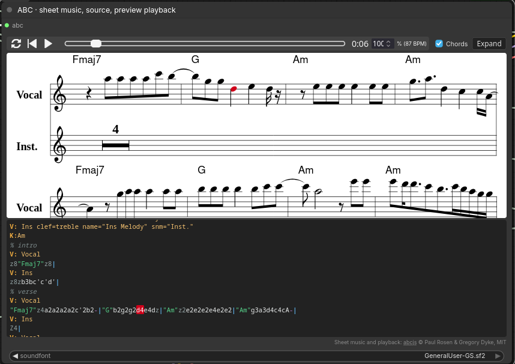

# ComfyUI-ABCPreview



**ABC Preview (Sheet Music + Playback)** (`bno84.ABCPreview`) shows an ABC score
in a node:

- sheet music rendered with [abcjs](https://github.com/paulrosen/abcjs);
- the ABC source with syntax highlighting;
- click a note in either view to locate it in the other;
- optional playback with play/pause, seek, loop, tempo, chords on/off, and
  notes highlighted in both views as they sound;
- **Expand** opens a larger side-by-side view (Esc or Close returns).

The node is a leaf output: connect any `STRING` with ABC. Changing its
soundfont never invalidates upstream generation. The view updates after the
node executes; it is a read-only preview, not an editor.

## Install

- **ComfyUI-Manager:** search for *ABC Preview* (Registry ID
  `comfyui-abcpreview`) and install it.
- **comfy-cli:** `comfy node install comfyui-abcpreview`.
- **Manually:** `git clone https://github.com/bno84/ComfyUI-ABCPreview` into
  `ComfyUI/custom_nodes/`.

Then restart ComfyUI. Requires ComfyUI 0.38.0 or newer; no extra Python
packages.

## Playback needs a user-supplied soundfont

No sounds are bundled or downloaded. Put a General MIDI `.sf2` file in
`ComfyUI/models/soundfonts/` (or a `soundfonts:` entry in
`extra_model_paths.yaml`), refresh the browser, and choose it. With `(none)`,
or when a workflow names a font this machine lacks, notation still works and
playback stays disabled; the workflow still runs. Each soundfont keeps its own
license; this pack's MIT license does not cover it.

The backend renders each requested instrument/pitch once on demand: one fixed
velocity, held up to 6 seconds, mono 22.05 kHz, cached in memory (up to 256
notes, about 70 MB). It honours sample zones, root key/tuning, loops,
attenuation, and the volume envelope; filters, modulators, LFOs, effects, and
stereo are ignored. SF3 (compressed)
fonts are not supported. This previews what the ABC says, not how the final
song sounds. Rendering is CPU-only and takes a few milliseconds per note.

## Vendored code

`vendor/abcjs/` holds [abcjs 6.7.2 from npm](https://www.npmjs.com/package/abcjs/v/6.7.2)
(`abcjs-basic-min.js`, `abcjs-audio.css`), MIT, © Paul Rosen and Gregory
Dyke; see `vendor/abcjs/LICENSE.md`. Its default remote soundfont URLs are
never used.
It is served by a pack route instead of `web/`, because ComfyUI imports every
`web/*.js` as a module.

## Tests

```bash
node --test tests/test_abc_preview.mjs     # tokenizer and extension wiring
python3 -m unittest discover -s tests      # renderer; needs numpy
```
